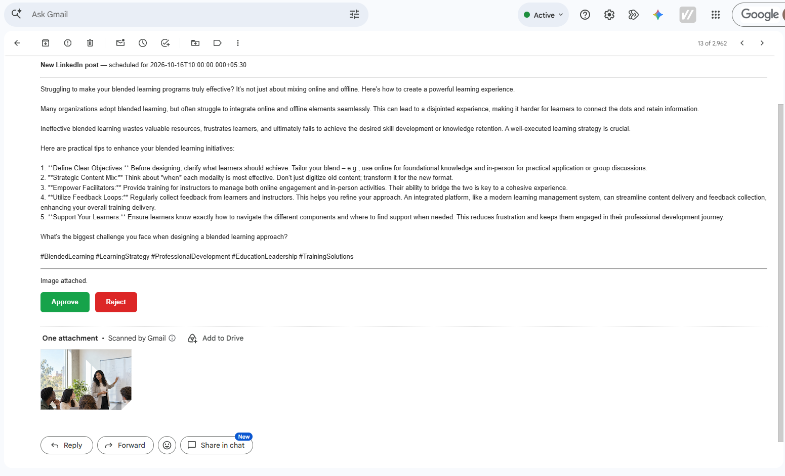
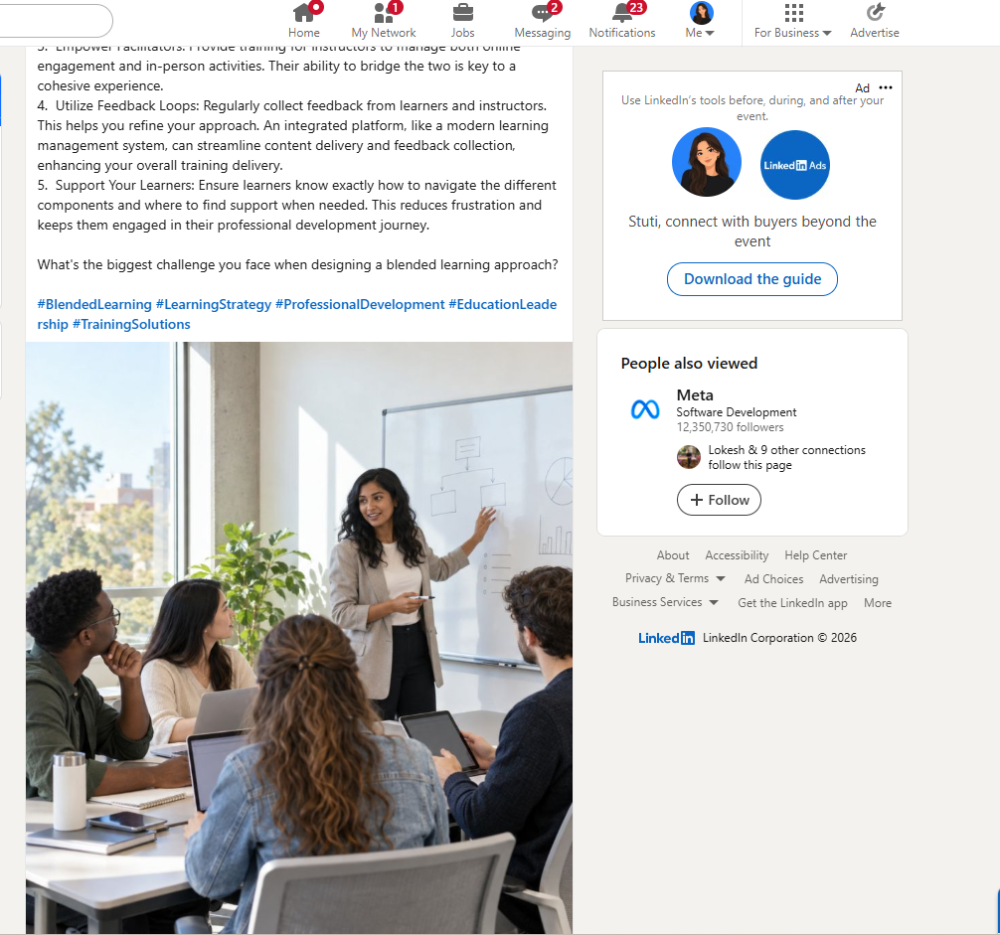
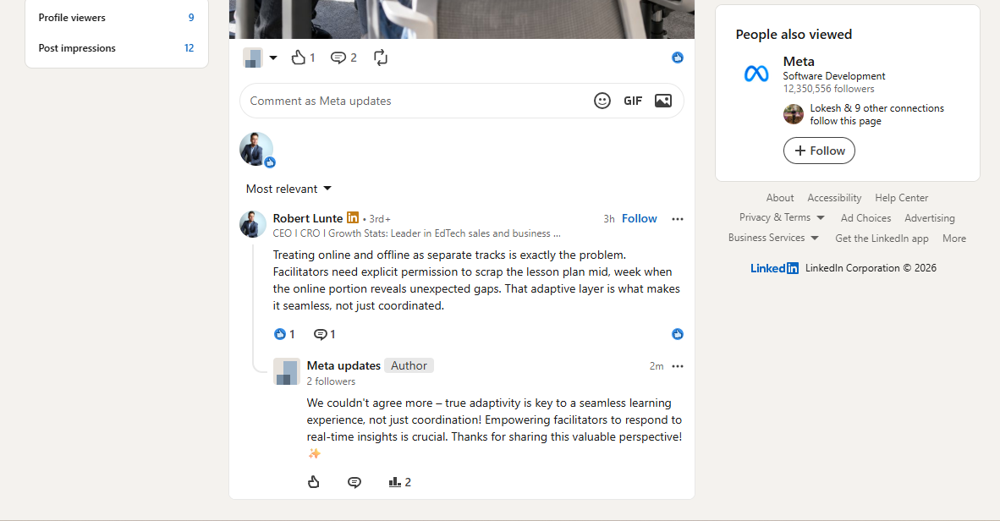
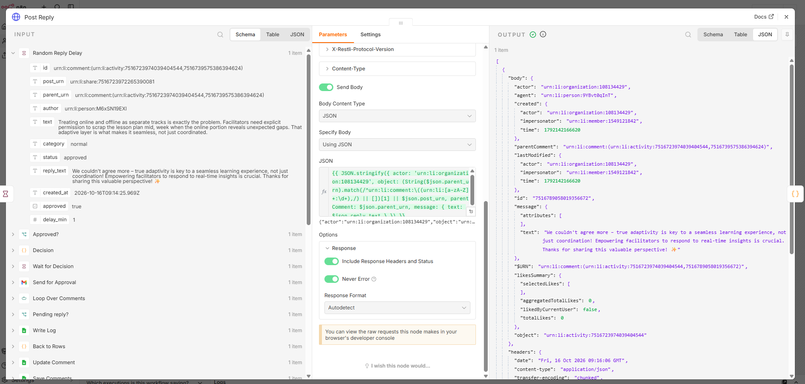
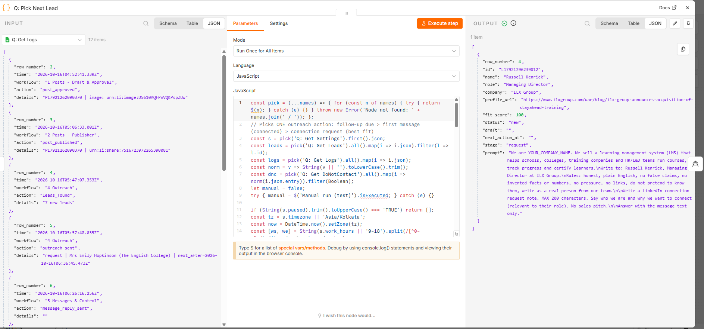
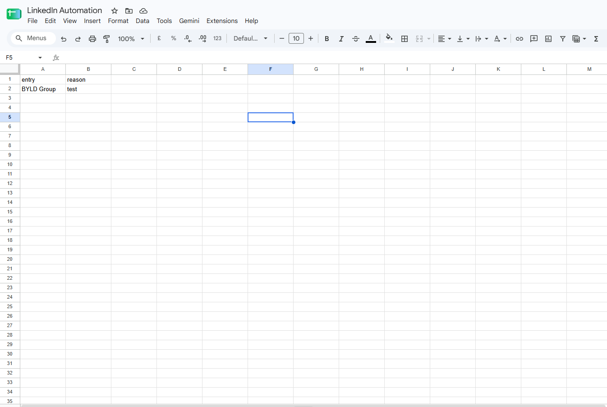

# LinkedIn Automation for an LMS company (n8n)

An n8n automation that, after we set only the **target audience and a few numbers**, finds likely customers, prepares daily outreach, helps answer messages using the full chat, publishes posts and replies to comments, all inside LinkedIn's rules. **A person approves everything AI writes, and a person sends every LinkedIn message.**

**Stack:** n8n (self-hosted) · Google Sheets (settings, data, logs) · Google Gemini (AI) · Gmail (approval emails with Approve / Reject buttons) · LinkedIn official API · Tavily (web search for leads) · CometAPI (post images)

---

## Demo

🎥 **Demo video:** [Watch on Google Drive](https://drive.google.com/file/d/1sVXYTZL5ddebEJV6xxOez4B-60E2_F7t/view?usp=sharing)

| Approval email: post text + image, Approve / Reject | Approved post live on the company page |
|---|---|
|  |  |
| **Real comment from an EdTech CEO → liked by the page → AI reply posted in the same thread** | **n8n: the approved reply posted through the official LinkedIn API** |
|  |  |
| **Outreach queue: picks the next best-fit lead (fit score) after checking Logs for limits and gaps** | **Do-not-contact list: checked before every outreach action** |
|  |  |

---

## 1. Workflows

| # | Workflow | Trigger | What it does |
|---|---|---|---|
| 1 | **Posts – Draft & Approval** | Weekdays 8:00 + manual | Plans today's post slots (posts_per_day, ≥ 4 h gap, working hours) → AI writes the post in our voice + an image prompt → image generated → **one approval email (text + image, Approve / Reject)** → approved image uploaded to LinkedIn → Posts row `approved` / `rejected` |
| 2 | **Posts – Publisher** | Every 15 min | Pause / 429 / working hours / daily limit / 4 h gap checks → publishes ONE due approved post to the company page (official Posts API, with image) → `published` + post link. 429 → no calls until midnight UTC. Any other error → **pause everything + alert** |
| 3 | **Comments** | Every 30 min, runs only every `check_interval_min` | Reads new comments **and replies** on our posts (whole thread) → AI classifies spam / abusive / needs a person / normal and drafts a reply for the same thread → **likes** non-spam comments → escalates hard questions by email → normal: approval email → random **5–30 min** wait → reply posted in the same thread |
| 4 | **Outreach** | A: weekdays 8:30 · B: every 20 min | **A. Find leads:** AI plans web searches from the target audience → Tavily (linkedin.com excluded) → AI extracts only explicitly named people + **fit score** → drops duplicates, do-not-contact, fit < 60. **B. Daily queue:** one action at a time: follow-up due (once, after 5 days) › first message (only after they accepted) › connection request (best fit). Stops at `outreach_per_day`, random **20–40 min** gap. AI drafts → email to a person → **the person sends it on LinkedIn** → clicks *I sent it* / *Skip* |
| 5 | **Messages & Control** | Forms + weekdays 18:15 | **Message form:** paste the whole chat → AI reads all of it → *stop* → do-not-contact · *price dispute / complaint / asks for a person* → escalation email · *normal* → reply draft → approve → person sends. **Control form:** connection accepted / they replied / said no / delete their data / **PAUSE everything** / resume. **Daily report** email from the Logs |

## 2. Google Sheet (single source of truth)

| Tab | Columns |
|---|---|
| **Settings** | key, paused, target_audience, outreach_per_day, outreach_gap, work_hours, timezone, posts_per_day, post_gap_hours, check_interval_min, reply_delay, followup_days, daily_report |
| **Leads** | id, name, role, company, profile_url, fit_score, status, draft, next_action_at |
| **DoNotContact** | entry, reason |
| **Posts** | id, text, status, scheduled_at, published_at, post_urn, image_urn |
| **Comments** | id, post_urn, parent_urn, author, text, category, status, reply_text, created_at |
| **Logs** | time, workflow, action, details |

Only the settings listed in the brief are in **Settings**; technical values (org ID, API version) live in the workflows. Approval mode is not a setting: it is **always on** for posts, comment replies and messages.

Lead status flow: `new → request_sent → connected → messaged → followed_up` (or `replied` / `do_not_contact` / `skipped` / `deleted`).

## 3. Every rule from the brief → where it is enforced

| Rule | How |
|---|---|
| No bots / scripts / browser extensions, no profile scraping | Only LinkedIn's official API (posts, comments, reactions). Leads come from the public web via Tavily with `linkedin.com` excluded; LinkedIn URLs are never stored as lead data |
| A person sends each LinkedIn message | Messages API is partner-only. AI drafts → email → the person sends on LinkedIn → clicks *I sent it*. Nothing is sent automatically |
| Never above our numbers | Gates read Settings + Logs before every action: `outreach_per_day`, `posts_per_day`, ≥ 4 h between posts, weekdays + `work_hours` in the audience timezone |
| Random gaps, no bursts | Outreach: random `outreach_gap` (20–40 min) stored in Logs, one lead at a time (nothing new while a draft awaits a decision). Comment replies: random `reply_delay` (5–30 min) |
| API limits / 429 | Calls are spread out (15–30 min schedules, max 5 posts checked). A 429 is logged as `rate_limited` and **all** workflows stop calling LinkedIn until midnight UTC. **No retry loop** |
| Stops on any warning | Any non-429 error when **publishing a post or posting a reply** → `paused = TRUE` + alert email (read-only calls such as fetching comments are skipped and retried at the next check). A warning seen in LinkedIn (restriction, verification) → **Control form → PAUSE everything** |
| One pause button + log of every action | `Settings.paused` is checked first by every workflow. Every action writes a row to **Logs** |
| One first message per person, no repeats, no pressure | Status machine on each lead; one follow-up only, then never contacted again. *Said no* → DoNotContact, checked before every action |
| Honest messages, clear way to say no | Prompts forbid false claims, invented facts/prices and pretending; first messages end with an easy opt-out |
| A person approves everything AI writes | Gmail Approve / Reject for every post, comment reply and message (LinkedIn Developer AI Policy) |
| Messages only to 1st-degree connections | First message is drafted only after the person marks *Connection accepted* |
| Keep LinkedIn data only as long as allowed | Only needed fields are stored. *Delete their data* wipes the lead row (kept only as a do-not-contact entry so they are never contacted again) |
| Replies use the full chat | Message form takes the whole conversation; comments use the whole thread |
| Price disputes / complaints / requests for a human → a person | AI classification + a keyword safety net on the latest message → escalation email, no AI reply |
| Spam / abusive comments skipped | Classified `skipped`: not liked, not answered |

## 4. LinkedIn API: what we use and why

| Need | Decision |
|---|---|
| Where we post | **Company page**, via Community Management API scopes (`w_organization_social`, `r_organization_social`, `rw_organization_admin`). Verified with `organizationAcls` (200) |
| Posting | `POST /rest/posts` (+ `rest/images` upload for the image). Live and working |
| Reading comments / replies, replying, liking | `v2/socialActions/{urn}/comments` and `v2/reactions`. The versioned `/rest/socialActions` endpoint returned **403** for this app's access tier while the v2 endpoint works with the same token |
| Sending messages / connection requests | **Not possible by API for us.** The Messages API is partner-only (Marketing Partner Program) and requires the member to press send; there is no public connection-request API. So: AI drafts, a person sends |
| Rejected | Browser automation / extensions / scraping (forbidden) · Member Data Portability API (read-only, own data only, not useful) · Buffer (allowed, but kept direct API; Buffer would be a fallback for posting only) |

Daily call limits are not published by LinkedIn; they are checked in the Developer Portal (Analytics) and the automation stays far below them.

**"To confirm first" from the brief: status**

| # | Item | Status |
|---|---|---|
| 1 | Apply for API access for posting and comment management | Done: Community Management scopes active on our app |
| 2 | Can we read comments and reply inside threads? | Yes, for the company page (`v2/socialActions`), tested live |
| 3 | Messages by API | Partner-only, so a person pastes the chat and sends the AI-drafted, approved reply |
| 4 | Daily call limits | Checked in the Developer Portal; the automation makes only a few calls per hour |
| 5 | Where we post | Company page (Community Management API) |

## 5. Setup

1. Create the Google Sheet with the 6 tabs above (exact names and headers) and fill **Settings**.
2. Import the 5 JSON files into n8n. In each, replace the placeholders: `YOUR_GOOGLE_SHEET_ID`, `YOUR_ORG_ID`, `YOUR_LINKEDIN_TOKEN`, `YOUR_APPROVAL_EMAIL@gmail.com`, `YOUR_COMPANY_NAME`, `YOUR_TAVILY_KEY`, `YOUR_COMET_KEY`.
3. Select credentials: Google Sheets, Gmail, Google Gemini.
4. LinkedIn token: Developer Portal → Token Generator with `w_organization_social`, `r_organization_social`, `rw_organization_admin`, `r_organization_admin`.
5. Test each workflow with **Manual run** (manual runs skip working hours / intervals; pause still applies), then activate.

> Approval buttons resume the workflow through n8n's URL, so n8n must be reachable from where the email is opened.

## 6. How it was tested

Everything below was run in n8n against the real Google Sheet, Gmail and the real LinkedIn company page. Time-based edge cases (429, 5-day follow-up) were simulated so they could be shown without waiting days.

| Case | Result |
|---|---|
| **Live:** post drafted → approved by email → published on the company page with its image | ✅ |
| Second publisher run same day | ✅ nothing published (daily limit) |
| **Live:** a real comment from an EdTech CEO on our company post → liked by the page → AI reply drafted from the thread → approved by email → posted in the same thread as the page ("Author") | ✅ |
| Price comment / spam comment | ✅ escalated / skipped |
| Leads found from the web with fit score, duplicates + do-not-contact removed | ✅ |
| Outreach draft → person sends → status + random gap in Logs → second run waits | ✅ |
| Message chat: normal / price dispute / "please stop" | ✅ reply draft / escalation / do-not-contact |
| PAUSE from control form → every workflow stops → Resume | ✅ |
| 429 and API error paths | ✅ simulated with pinned responses: `rate_limited` logged / paused + alert |
| 5-day follow-up | ✅ simulated by setting `next_action_at` in the past |

## 7. Limitations and next steps

- Messages are read by pasting the chat (no partner Messages API). With partner access, the same flow can read chats and create drafts in LinkedIn.
- The person marks *Connection accepted* in the control form; there is no API to read invitation status.
- LinkedIn tokens expire (60 days): next step is an n8n OAuth2 credential with automatic refresh.
- Next: weekly cleanup of old comment/chat text, A/B testing of post hooks, a small dashboard on top of the Logs tab.
